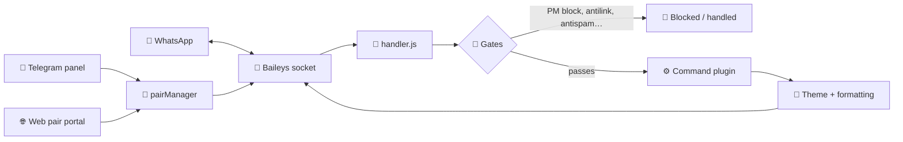
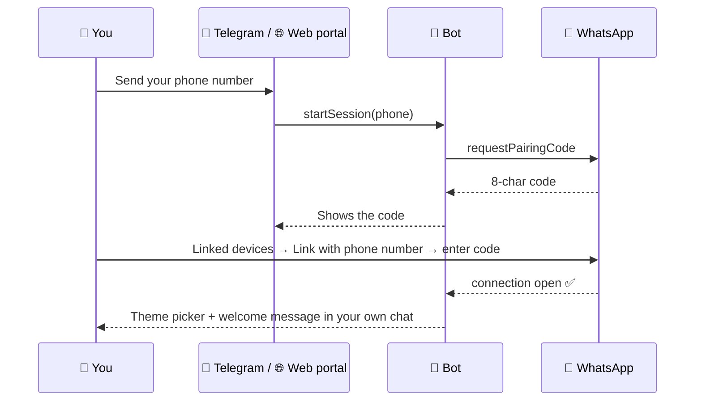

<div align="center">


<a href="https://git.io/typing-svg">
  
</a>

<br/>


[](https://t.me/madaraxinc)
[](https://whatsapp.com/channel/YOUR_CHANNEL_ID)
[](https://madaraweb.dpdns.org)


> _"Those who cannot acknowledge themselves will eventually fail."_ — **Madara Uchiha** 🔴

</div>

---

## 📑 Table of Contents

- [✨ What is this?](#-what-is-this)
- [🔥 Features](#-features)
- [🧠 How it works](#-how-it-works)
- [⚡ Quick start (60 seconds)](#-quick-start-60-seconds)
- [🔗 Pairing your number](#-pairing-your-number)
- [🚀 Deployment](#-deployment)
  - [🖥️ Hosting panels (Pterodactyl-style)](#️-hosting-panels-pterodactyl-style)
  - [🐧 VPS (Ubuntu / Debian)](#-vps-ubuntu--debian)
  - [🐳 Docker](#-docker)
  - [☁️ Other hosts](#️-other-hosts)
- [⚙️ Configuration](#️-configuration)
- [🎮 Command cheat sheet](#-command-cheat-sheet)
- [🛒 Shop & Files system](#-shop--files-system)
- [🛠️ Telegram admin panel](#️-telegram-admin-panel)
- [📁 Project structure](#-project-structure)
- [🩺 Troubleshooting](#-troubleshooting)
- [🔄 Updating](#-updating)
- [⚠️ Disclaimer](#️-disclaimer)
- [💖 Credits](#-credits)

---

## ✨ What is this?

**MADARA X-MD** is a multi-device **WhatsApp bot** built on Node.js and Baileys. One deployment can run **multiple paired numbers at once**, each with its own prefix, theme, and settings. It ships with **1600+ commands** across AI, media, groups, economy, stickers, tools, and more, plus a **Telegram admin panel** and a **web pairing portal** so you don't have to touch a terminal just to link a number.

Think of it as the group-chat main character: it moderates, it plays music, it posts statuses, it runs a shop, and it still has time to roast your friends. 💅

| | |
|---|---|
| 🧬 **Engine** | `@itsliaaa/baileys` (multi-device, custom pairing code support) |
| 🧱 **Runtime** | Node.js 20+ |
| 👥 **Sessions** | Multiple numbers, fully isolated settings per session |
| 🎨 **Themes** | Akatsuki, Itachi, Madara, Naruto, Sharingan — picked on first connect |
| 🤖 **Admin** | Telegram bot panel + web pairing portal |

---

## 🔥 Features

<details open>
<summary><b>🎛️ Core</b></summary>

- ✅ **Multi-session** — pair as many numbers as your server can handle
- ✅ **Per-session config** — prefix, command mode, theme, footer, all isolated
- ✅ **Multi-prefix + no-prefix mode** — type `ping` or `.ping`, your call
- ✅ **Pairing codes** — normal *or* custom 8-character code
- ✅ **Sudo / owner / dev-owner tiers** — destructive commands stay dev-only
- ✅ **Smart cooldowns** and rate limiting so spam doesn't nuke your session
- ✅ **Unified menu style** — every category menu shares one look
- ✅ **Health monitor** — RAM/heap logging in the console

</details>

<details>
<summary><b>👥 Group management</b></summary>

- 🛡️ Anti-link, anti-spam, anti-badword, anti-delete, anti-group-mention, anti-status-mention
- 🔇 Mute / warn / kick / promote / demote tools
- 📊 Top members tracking, welcome + goodbye cards, join-request handling
- 🎚️ **Group response control** — decide which groups the bot answers in (`.response`, `.group on/off`)
- 📣 **Group status posting** — `.gstatus` / `.allstatus` with proper **rich link previews**

</details>

<details>
<summary><b>🎵 Media & downloads</b></summary>

- 🎧 `.play` — search + download audio (yt-dlp first, with fallbacks)
- 🎬 YouTube / TikTok / Instagram / Facebook / Pinterest / Twitter(X) downloaders
- 🖼️ Sticker maker, sticker-to-image, text-to-picture, emoji mixer
- 🔄 Converters (audio, video, image, PDF) powered by ffmpeg + sharp
- 👻 `.ghost` — silently pull a view-once to your own DM, zero trace in the chat
- 🖼️ `.getpp` — grab anyone's profile picture

</details>

<details>
<summary><b>🤖 AI & utilities</b></summary>

- 🧠 AI chat, image generation, code helpers, translators, TTS, OCR
- 🔎 Search tools, weather, lyrics, dictionary, QR, shorteners, screenshots
- 🌍 Language tools and auto-translate

</details>

<details>
<summary><b>🎮 Fun, games & economy</b></summary>

- 🎲 Word games, trivia, roast battles, hangman, chess, and more
- 💰 Economy: daily, work, bank, transfer, leaderboard
- 😂 Memes, jokes, truth-or-dare, compliments, and chaos

</details>

<details>
<summary><b>🛒 Commerce</b></summary>

- 🎮 **Game account store** — browse and order accounts
- 📁 **Files shop** — free drops + paid files with Track-ID order flow
- 💸 Vendor gets the order in their DM; the bot never hands out paid files on its own

</details>

---

## 🧠 How it works



Every incoming message goes through context building (who sent it, are they admin/owner, which session), a chain of moderation gates, then the matching command plugin. Replies pass through the session's theme before they hit WhatsApp.

---

## ⚡ Quick start (60 seconds)

```bash
git clone https://github.com/gbolahanraifu1-oss/Madara-X-MD/tree/legacy-before-v1.2.git
cd YOUR_REPO
npm install
cp .env.example .env      # then edit it
npm start
```

When the console says `✅ MADARA X-MD is fully operational`, you're live. Now pair a number 👇

> [!TIP]
> No `.env.example`? Create a `.env` file in the project root and use the variables from the [Configuration](#️-configuration) section.

---

## 🔗 Pairing your number



**Step by step**

1. Open the **Telegram bot** or the **web pairing portal**.
2. Enter your number with country code, no `+` and no spaces (example: `234XXXXXXXXXX`).
3. Copy the pairing code the bot gives you.
4. On your phone: **WhatsApp → Settings → Linked devices → Link a device → Link with phone number instead**.
5. Type the code. Done. ✅

> [!NOTE]
> Right after pairing you'll usually see **`Stream Errored (restart required)` / code `515`** in the console. That's **normal**. The bot keeps your creds and reconnects on its own. Don't panic, don't re-pair.

**Pairing modes**

| Mode | What you get |
|---|---|
| `normal` | WhatsApp generates a random code |
| `custom` | Uses your 8-character `PAIRING_CODE` from `.env` (letters + numbers only) |

---

## 🚀 Deployment

Pick your fighter. All of these run the exact same bot.

| Option | Difficulty | Best for |
|---|---|---|
| 🖥️ Hosting panel | 🟢 Easy | Beginners, free/cheap bot hosts |
| 🐧 VPS + PM2 | 🟡 Medium | Full control, 24/7 uptime |
| 🐳 Docker | 🟡 Medium | Clean, reproducible setups |
| ☁️ PaaS (Railway/Render) | 🟠 Hmm | Only with a **persistent volume** |

> [!IMPORTANT]
> Whatever you pick, **`sessions/` and `data/` must survive restarts.** `sessions/` holds your WhatsApp logins. Lose it and every number has to re-pair.

---

### 🖥️ Hosting panels (Pterodactyl-style)

Works on panels where your files live in `/home/container` (HidenCloud and similar).

**1. Create the server**
- Egg / runtime: **Node.js** (pick **20 or higher**).
- RAM: **1 GB minimum**, **2 GB+** if you run several sessions or heavy media commands.

**2. Upload the bot**
- Open **File Manager** → upload the project `.zip` → **Unarchive**.
- Make sure `package.json` and `index.js` sit directly in the root, not inside a nested folder.

**3. Add your config**
- Create `.env` in the root (see [Configuration](#️-configuration)).

**4. Startup settings**
- Startup command: `npm start` (same as `node index.js`).
- If your panel has an **auto-install on start** option, turn it on so dependencies install on boot.

**5. Install & start**
- Hit **Start**. First boot runs `npm install` and takes a few minutes.
- Watch the console for:
  ```
  ✅ Loaded NNNN command plugins
  ✅ MADARA X-MD is fully operational
  ```

**6. Approve blocked install scripts** (newer npm versions)

If you see:

```
npm warn install-scripts 6 packages had install scripts blocked…
```

some packages (like `youtube-dl-exec`, `sharp`, `ffmpeg-static`, `puppeteer`) didn't finish setup. Run in the panel console or terminal:

```bash
npm install-scripts ls
npm install-scripts approve youtube-dl-exec
npm install-scripts approve sharp
npm install-scripts approve ffmpeg-static
npm install
```

Approve only what you need. `youtube-dl-exec` is the one that downloads the **yt-dlp** binary, so `.play` needs it.

> [!WARNING]
> **Don't add startup variables that uninstall packages** (some panels have an "uninstall packages" field). If `@itsliaaa/baileys` keeps vanishing from `package.json` every time you start the server, that's the culprit. Clear that variable.

> [!TIP]
> Seeing `49 vulnerabilities` after install? That's an `npm audit` report on dependencies. **Don't run `npm audit fix --force`**, it can break the bot by forcing major version bumps.

---

### 🐧 VPS (Ubuntu / Debian)

Tested flow for Ubuntu 22.04 / 24.04.

**1. System packages**

```bash
sudo apt update && sudo apt upgrade -y
sudo apt install -y git curl ffmpeg build-essential python3
```

**2. Node.js 20**

```bash
curl -fsSL https://deb.nodesource.com/setup_20.x | sudo -E bash -
sudo apt install -y nodejs
node -v   # should print v20.x or higher
```

**3. Get the bot**

```bash
git clone https://github.com/YOUR_USERNAME/YOUR_REPO.git madara-xmd
cd madara-xmd
npm install
nano .env          # paste your config
```

**4. Test run**

```bash
npm start
```

**5. Keep it alive with PM2**

```bash
sudo npm install -g pm2
pm2 start index.js --name madara-xmd
pm2 save
pm2 startup        # run the command it prints, then:
pm2 save
```

**Handy PM2 commands**

| Command | What it does |
|---|---|
| `pm2 logs madara-xmd` | Live logs |
| `pm2 restart madara-xmd` | Restart |
| `pm2 stop madara-xmd` | Stop |
| `pm2 monit` | CPU/RAM dashboard |

**6. (Optional) Firewall + web portal**

If you expose the pairing portal, put it behind a reverse proxy:

```bash
sudo apt install -y nginx
sudo ufw allow OpenSSH
sudo ufw allow 'Nginx Full'
sudo ufw enable
```

Then proxy your domain to the portal's port and add HTTPS with `certbot`.

> [!TIP]
> **YouTube rate limits (HTTP 429)** are common on datacenter IPs. If `.play` complains, that's YouTube throttling your server's IP, not a bug. Residential or lightly used IPs fare better.

---

### 🐳 Docker

**`Dockerfile`**

```dockerfile
FROM node:20-bookworm-slim

RUN apt-get update && apt-get install -y --no-install-recommends \
    ffmpeg git python3 ca-certificates \
 && rm -rf /var/lib/apt/lists/*

WORKDIR /app
COPY package*.json ./
RUN npm install --omit=dev
COPY . .

CMD ["node", "index.js"]
```

**`docker-compose.yml`**

```yaml
services:
  madara-xmd:
    build: .
    container_name: madara-xmd
    restart: unless-stopped
    env_file: .env
    volumes:
      - ./sessions:/app/sessions
      - ./data:/app/data
      - ./shop:/app/shop
```

```bash
docker compose up -d --build
docker compose logs -f
```

> [!NOTE]
> If a dependency like `puppeteer` tries to download a browser during build and you don't use browser-based commands, set `PUPPETEER_SKIP_DOWNLOAD=true` as a build env var to keep the image small.

---

### ☁️ Other hosts

Railway, Render, Koyeb and friends can run it, **but** their filesystems are usually **ephemeral**. Attach a **persistent volume** and mount it at `sessions/` and `data/`, or you'll re-pair after every deploy. If a host can't give you persistent storage, pick a panel or VPS instead.

---

## ⚙️ Configuration

Create a `.env` file in the project root:

```env
# ── Owner ──────────────────────────────
OWNER_NUMBER=234XXXXXXXXXX        # dev owner, digits only, with country code
OWNER_NAME=Your Name

# ── Branding ───────────────────────────
BOT_NAME=ᴍᴀᴅᴀʀᴀ x-ᴍᴅ

# ── Pairing ────────────────────────────
PAIRING_CODE=MADARA01             # exactly 8 letters/numbers, used in custom mode

# ── Channel / community links ──────────
NEWSLETTER_JID=120363XXXXXXXXXXXX@newsletter
TG_CHANNEL_1_URL=https://t.me/madaraxinc
TG_GROUP_URL=https://t.me/your_support_group
TG_TUTORIAL_URL=https://t.me/your_tutorial_video

# ── Shop ───────────────────────────────
VENDOR_NUMBER=234XXXXXXXXXX       # gets paid-file order notifications (falls back to OWNER_NUMBER)

# ── Telegram admin panel ───────────────
TELEGRAM_BOT_TOKEN=               # from @BotFather
```

| Variable | Required | Purpose |
|---|---|---|
| `OWNER_NUMBER` | ✅ | Dev owner. Only this number can run dev-only commands (`.restart`, `.shutdown`) |
| `OWNER_NAME` | ➖ | Display name in menus |
| `BOT_NAME` | ➖ | Bot name shown across the UI |
| `PAIRING_CODE` | ➖ | 8-char code for custom pairing mode |
| `NEWSLETTER_JID` | ➖ | WhatsApp channel the bot follows and forwards from |
| `TG_*_URL` | ➖ | Links shown in menus/buttons |
| `VENDOR_NUMBER` | ➖ | Receives paid-file orders |
| `TELEGRAM_BOT_TOKEN` | ✅ for panel | Telegram admin/pairing bot |

> [!CAUTION]
> **Never commit `.env` or `sessions/` to Git.** Add them to `.gitignore`:
> ```gitignore
> .env
> sessions/
> data/
> node_modules/
> ```

---

## 🎮 Command cheat sheet

Default prefix is **`.`** (changeable per session with `.setprefix`). Type **`.menu`** for the full list.

| Category | Try these |
|---|---|
| 🏠 **Main** | `.menu` `.alive` `.ping` `.uptime` `.ram` |
| 🎵 **Media** | `.play <song>` `.ytmp3` `.ytmp4` `.tiktok` `.sticker` |
| 👥 **Group** | `.kick` `.promote` `.demote` `.mute` `.antilink` `.welcome` |
| 🎛️ **Response control** | `.response on/off/list/only` `.group on/off` |
| 📣 **Status** | `.gstatus` `.allstatus` (also `.gcstatus`) |
| 🛒 **Commerce** | `.shop` `.files` `.buyfile <ID>` |
| 🕵️ **Stealth** | `.ghost` (reply to a view-once) |
| 🖼️ **Profile** | `.getpp @user` |
| 👑 **Owner** | `.prefix` `.restart` `.shutdown` *(dev only)* |

> [!TIP]
> Turn on **no-prefix mode** and you can just type `ping`, `menu`, or `play never gonna give you up`. Only exact command names trigger, so normal chat stays safe.

---

## 🛒 Shop & Files system

Two stores, one rule: **free stuff is instant, paid stuff goes through an order.**

```
shop/files/
├── sensitivity/        ← FREE. Bot asks your device model, sends the match (or default.txt)
├── freebies/           ← FREE. Sent directly when files exist
├── macro/      {android,iphone}/   ← PAID
├── headshots/  {android,iphone}/   ← PAID
├── proxy/      {android,iphone}/   ← PAID
├── vvipproxy/  {android,iphone}/   ← PAID
└── config/     {android,iphone}/   ← PAID
```

**Paid flow**

1. `.files macro` → pick **Android** or **iPhone**
2. Bot lists files with IDs and prices (example ID: `MACRO-ANDROID-1`)
3. `.buyfile MACRO-ANDROID-1` confirms the order
4. Bot generates a **Track ID** like `FF-FILE-8392`
5. Vendor gets your number, name, category, file, price, Track ID, and timestamp in their DM
6. You get the confirmation. **The bot never sends paid files itself.** The vendor handles payment and delivery.

Prices are set **per file** when the admin uploads through the Telegram panel (or fall back to the category default).

---

## 🛠️ Telegram admin panel

The Telegram bot is your remote control:

- 🔗 Pair and manage WhatsApp sessions
- 📁 **File Store manager** — upload files, set per-file prices, delete
- 🛒 **Shop manager** — add game-account listings with images
- 📊 Check status without opening a terminal

Create a bot with **@BotFather**, drop the token in `.env`, restart, and send `/start`.

---

## 📁 Project structure

```
.
├── index.js              # entry point
├── settings.js           # env-driven defaults
├── package.json
├── lib/                  # core: handler, context, pairManager, db, telegram, themes…
├── commands/             # 1600+ plugins, one folder per category
│   ├── ai/  converter/  finance/  fun/  group/  language/
│   ├── media/  misc/  owner/  search/  sticker/  system/  utility/
├── utils/                # shared helpers (status posting, styling, fonts…)
├── themes/               # akatsuki · itachi · madara · naruto · sharingan
├── shop/files/           # files store (free + paid categories)
├── sessions/             # 🔐 WhatsApp logins (never commit)
└── data/                 # 💾 runtime database (never commit)
```

**Writing your own command**

```js
// commands/utility/hello.js
module.exports = {
  name: 'hello',
  aliases: ['hi2'],
  category: 'utility',
  desc: 'Say hello',
  usage: '.hello',
  async execute(sock, msg, args, ctx) {
    await ctx.reply(`Yo ${ctx.pushName} 👋`);
  },
};
```

Drop it in `commands/<category>/`, restart, and it's live. Handy flags: `ownerOnly`, `devOnly`, `groupOnly`, `privateOnly`, `adminOnly`, `botAdminNeeded`.

---

## 🩺 Troubleshooting

<details>
<summary><b>❌ <code>Cannot find module '@itsliaaa/baileys'</code></b></summary>

Dependencies didn't install, or something removed the package. Check:
- `package.json` really lists `@itsliaaa/baileys`
- Your panel has **no startup variable that uninstalls packages**
- Run `npm install` again and read the output for errors

</details>

<details>
<summary><b>🔁 Stream Errored (restart required) / 515 right after pairing</b></summary>

Normal. It's part of the pairing handshake. The bot reconnects automatically and keeps your session.

</details>

<details>
<summary><b>🎧 <code>.play</code> fails</b></summary>

The error message lists which source failed:
- **yt-dlp error** → run `npm install-scripts approve youtube-dl-exec`, then `npm install`, so the binary downloads.
- **429** → YouTube is rate-limiting your server IP. Wait, or use a different host/IP.
- **403** from a third-party API → that API is blocking or dead. yt-dlp is the reliable path.

</details>

<details>
<summary><b>🤐 Bot doesn't answer in groups</b></summary>

- Check group response mode: run `.response on` (or `.group on` inside that group).
- Check the console for `[Handler] … failed` or error lines.
- Make sure the bot account is actually in that group and not restricted.

</details>

<details>
<summary><b>🔌 Linked device keeps getting removed</b></summary>

WhatsApp decides this server-side. Common causes:
- Your **phone has been offline** for a long time (the primary device must check in)
- Heavy spam / mass messaging / rapid re-pairing
- Running the same number on multiple servers at once

Keep the phone online, don't spam, and don't pair/unpair repeatedly.

</details>

<details>
<summary><b>🖼️ Stickers / media conversion fail</b></summary>

Install ffmpeg (`sudo apt install ffmpeg`) and approve install scripts for `sharp` / `ffmpeg-static` if your npm blocked them.

</details>

<details>
<summary><b>🧯 Bot crashes on startup</b></summary>

Run `node -c index.js` and read the first error, check your `.env` formatting, and confirm Node is **20+** (`node -v`).

</details>

---

## 🔄 Updating

**VPS / Docker**

```bash
git pull
npm install
pm2 restart madara-xmd          # or: docker compose up -d --build
```

**Panel**

1. Stop the server.
2. Upload and extract the new files, **but keep your `sessions/`, `data/`, `shop/` and `.env`**.
3. Start the server.

> [!TIP]
> Back up before big updates:
> ```bash
> tar -czf backup-$(date +%F).tar.gz sessions data shop .env
> ```

---

## ⚠️ Disclaimer

This project is **unofficial** and **not affiliated with, endorsed by, or connected to WhatsApp or Meta**. Automating WhatsApp can violate its Terms of Service and may lead to restrictions or bans on the numbers you connect. **Use at your own risk**, don't use it for spam, harassment, or illegal activity, and prefer a secondary number over your main one. The maintainers aren't responsible for account actions or misuse.

---

## 💖 Credits

- 🧬 [Baileys](https://github.com/WhiskeySockets/Baileys) and its community forks, for the WhatsApp Web protocol work
- 🎞️ [yt-dlp](https://github.com/yt-dlp/yt-dlp), [ffmpeg](https://ffmpeg.org), [sharp](https://sharp.pixelplumbing.com)
- 🎨 [capsule-render](https://github.com/kyechan99/capsule-render) and [readme-typing-svg](https://github.com/DenverCoder1/readme-typing-svg), for the animated README
- 🔴 Everyone who tests, reports bugs, and spreads the word

<div align="center">

### Built with 🔥 by **MADARA X-MD | INC.**

[](https://t.me/madaraxinc)
[](https://github.com/YOUR_USERNAME/YOUR_REPO)

_If this bot saved you time, a star is free and it makes us feel things._ 💅


</div>
